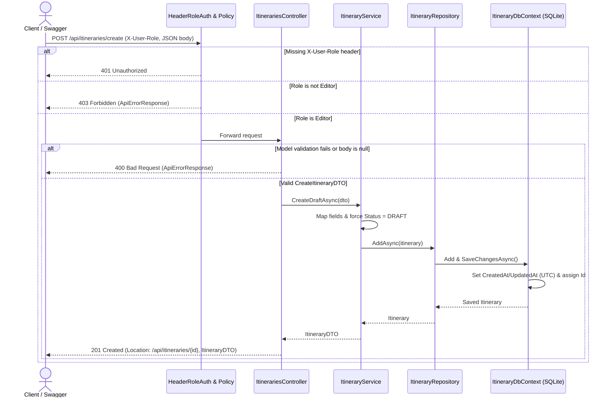

# Story 1 — Create Draft Itinerary

> **As an** editor, **I want** to create a new thematic itinerary in draft status, **so that** I can progressively define its contents before publication.

## Acceptance Criteria Status

| ID | Condition | Status |
|---|---|---|
| **AC01** | Authenticated editor creates an itinerary with title, theme, description, and geographic area | Implemented (`CreateItineraryDTO` + `Editor` role; auth currently uses placeholder `X-User-Role` header) |
| **AC02** | Itinerary starts in `DRAFT` status and is excluded from the published catalog | Implemented (`ItineraryService.CreateDraftAsync` forces `ItineraryStatus.DRAFT`) |
| **AC03** | System assigns a unique incremental identifier (and records responsible editor) | Incremental `Id` implemented (SQLite `AUTOINCREMENT`); responsible `EditorId`/`OwnerId` not yet added |
| **AC04** | Missing/invalid input reports the problem and does not save | Implemented (`400 Bad Request` with `ApiErrorResponse` on validation errors; `MaxLength` enforced) |
| **AC05** | Editor can reopen the draft and find previously saved data | Implemented (`GET /api/itineraries/{id}` -> `GetByIdAsync`) |

---

## Sequence Diagram (`POST /api/itineraries/create`)



---

## Current Architecture

| Layer | Folder / Files | Responsibility |
|---|---|---|
| **API / Presentation** | `Controllers/ItinerariesController.cs` | Exposes HTTP endpoints, enforces `CanCreateItinerary` policy / `Editor` role, maps exceptions to `ApiErrorResponse` |
| **Security (Placeholder)** | `Security/AppRoles.cs`, `HeaderRoleAuthHandler.cs`, `ApiAuthorizationMiddlewareResultHandler.cs` | Defines `Editor` / `Viewer` roles, `CanCreateItinerary` policy, reads `X-User-Role` header, formats `403 Forbidden` as `ApiErrorResponse` |
| **DTOs** | `DTO/CreateItineraryDTO.cs`, `ItineraryDTO.cs`, `ApiErrorResponse.cs` | Separates creation input (no `Id`, `Stops`, or `Status`) from full response payloads and structured errors |
| **Service** | `Services/IItineraryService.cs`, `ItineraryService.cs` | Business rules for Story 1: maps `CreateItineraryDTO` to `Itinerary` and forces `ItineraryStatus.DRAFT` |
| **Repository** | `Repositories/IItineraryRepository.cs`, `ItineraryRepository.cs` | EF Core data access for `Itinerary` aggregates, including ordered many-to-many `Stops` |
| **Persistence** | `Data/ItineraryDbContext.cs`, `Data/Configurations/`, `Data/Migrations/`, `Data/Scripts/InitialCreate.sql` | SQLite EF Core context, fluent table/constraint mapping, automatic UTC timestamps, migrations (applied at startup) |
| **Entities** | `Entities/Itinerary.cs`, `Stop.cs`, `Location.cs`, `ItineraryStatus.cs`, `ItineraryStop.cs` | Domain entities and DataAnnotation constraints |
| **Tests** | `../InteractiveItinerary.Tests/` | 27 xUnit tests using in-memory SQLite with migrations applied (`TestSqliteDb.cs`) |

---

## Endpoints

### `POST /api/itineraries/create`
Creates a new itinerary in `DRAFT` status. Stops are not included at creation time and are added later before publishing.

- **Auth / Headers:**
  - `Content-Type: application/json`
  - `X-User-Role: Editor` *(placeholder header; `Viewer` returns `403`, missing header returns `401`)*
- **Request Body (`CreateItineraryDTO`):**
  ```json
  {
    "title": "Hidden Rome",
    "description": "Backstreet churches and courtyards.",
    "theme": "Architecture",
    "geographicArea": "Rome, Italy"
  }
  ```
- **Responses:**
  - `201 Created`: Includes `Location: /api/itineraries/{id}` header and `ItineraryDTO` body:
    ```json
    {
      "id": 1,
      "title": "Hidden Rome",
      "description": "Backstreet churches and courtyards.",
      "theme": "Architecture",
      "stops": [],
      "status": 0,
      "createdAt": "2026-11-22T17:00:00Z",
      "updatedAt": "2026-11-22T17:00:00Z",
      "geographicArea": "Rome, Italy"
    }
    ```
  - `400 Bad Request`: `ApiErrorResponse` (`error: "ValidationError"`) when body is missing or field length constraints (`200` / `2000` chars) fail.
  - `401 Unauthorized`: Missing `X-User-Role` header.
  - `403 Forbidden`: Authenticated caller does not have the `Editor` role (`ApiErrorResponse` with `error: "Forbidden"`).

---

### `GET /api/itineraries/{id}`
Retrieves a saved itinerary (including drafts) by its system-assigned `id`.

- **Responses:**
  - `200 OK`: `ItineraryDTO` JSON body.
  - `404 Not Found`: `ApiErrorResponse` (`error: "NotFound"`) if no itinerary exists with that `id`.
